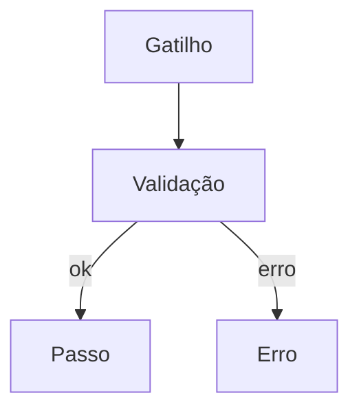

# Fluxo: <nome>

**Escopo:** <da entrada ao efeito final, em uma frase>
**Fora do escopo:** <o que não foi analisado>

## Diagrama

Legenda: nós sólidos = verificado no código; nós tracejados (`:::inferido`) = inferido.

## Passos

| ID | Passo | Evidência | Tipo |
|----|-------|-----------|------|
| F1 | <o que acontece> | `caminho/arquivo.py:10-20` | verificado |
| F2 | <o que acontece> | `caminho/arquivo.py:30` | inferido |

Escreva cada referência entre crases, no formato `caminho:linha` ou `caminho:inicio-fim`, uma por crase. O `check_refs.py` lê esse formato.

## Estado gravado

<tabela ou lista: o que muda de estado, em qual passo, e quem lê depois>

## O que já está bom (manter)

- <item com evidência>

## Pontos não cobertos / perguntas

- <o que depende de configuração ou de quem não está no código>
